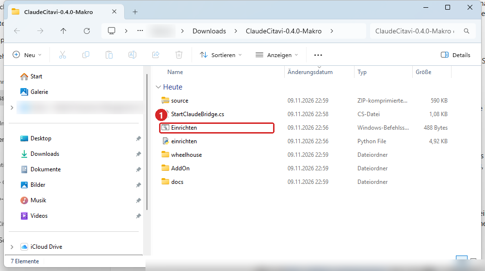
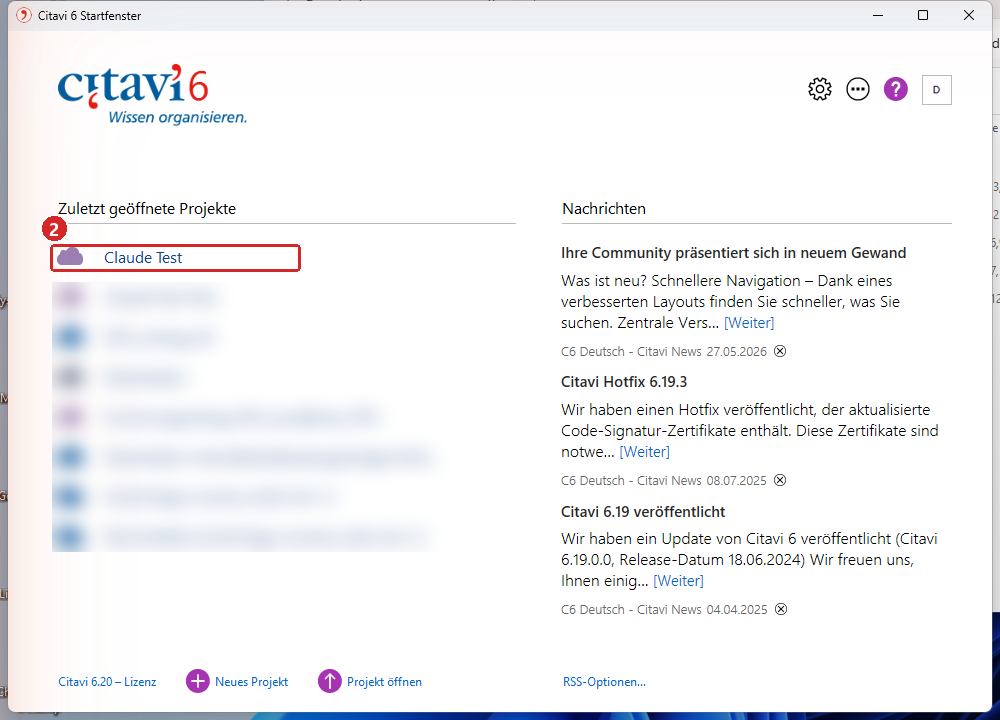
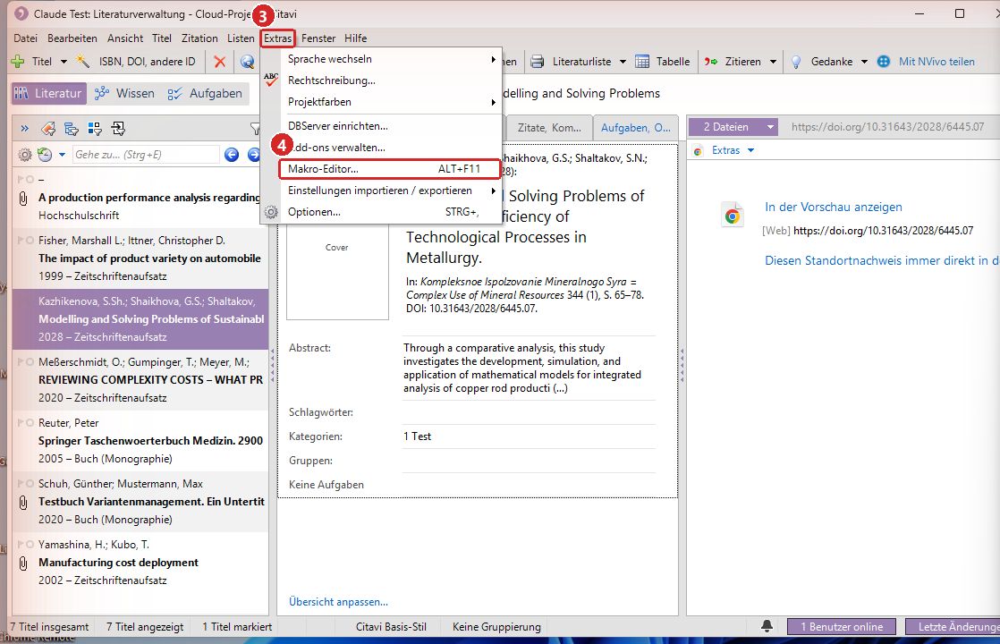
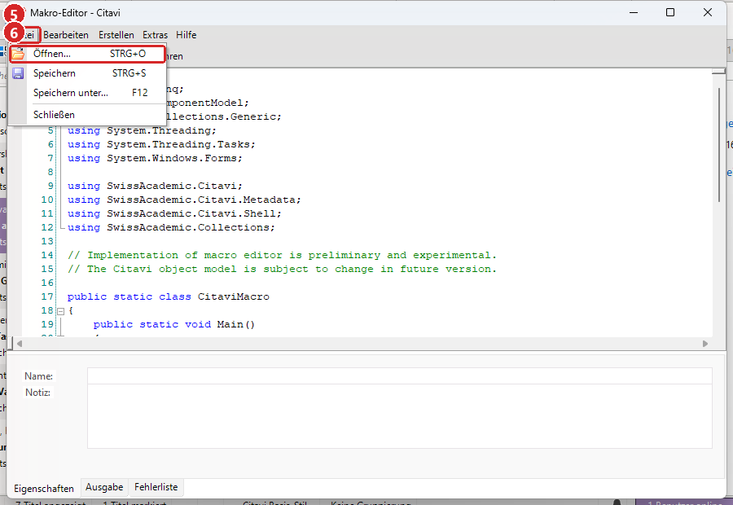
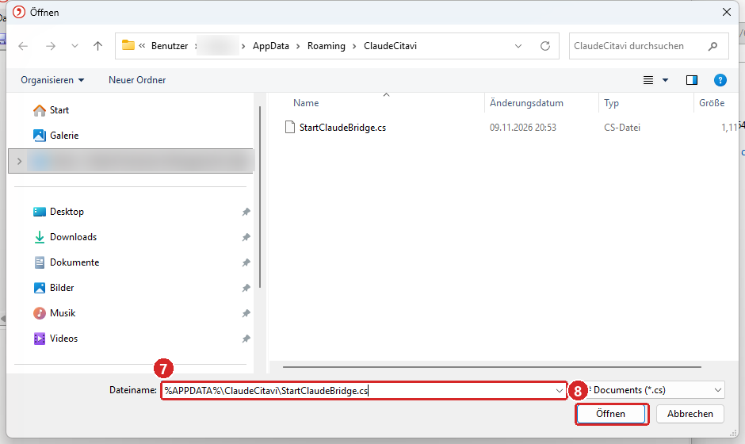
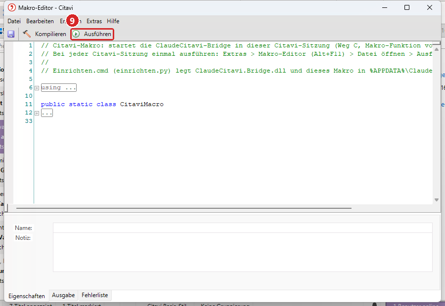
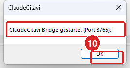

# Citavi mit Claude steuern über ein Citavi-Makro

Mit ClaudeCitavi arbeitet Claude direkt in deinem Citavi. Claude legt Titel an, hängt PDFs an, liest Quellen und
erfasst Wissenselemente mit Markierung im PDF. Diese Anleitung beschreibt Weg C: Die Verbindung startet über die
Makro-Funktion von Citavi. Dafür wird nichts in Programmordnern installiert. Du richtest einmal alles ein und startest
danach die Verbindung mit wenigen Klicks.

::: hinweis
**Bei jeder Citavi-Sitzung neu starten.** Die Verbindung läuft nur, solange Citavi offen ist. Nach jedem Neustart von
Citavi startest du das Makro wieder (Teil 2, etwa 1 Minute). Soll die Verbindung dauerhaft von selbst starten, kann die
IT deiner Einrichtung das Add-on einmalig installieren (Weg B, eigene Anleitung im Paket `ClaudeCitavi-0.4.1-AddOn.zip`).
Kläre vor der Nutzung auf einem Dienstrechner, ob Citavi-Makros und Claude nach den Regeln deiner Einrichtung genutzt
werden dürfen.
:::

## Was du brauchst

- Citavi 6 auf deinem Rechner und ein Citavi Projekt
- Claude Desktop mit deinem Konto
- das Paket `ClaudeCitavi-0.4.1-Makro.zip` aus den [Releases](https://github.com/DennisHertell/ClaudeCitavi/releases)
- Python 3.12, das du in Schritt A installierst, falls es noch fehlt

## Teil 1: einmal einrichten (etwa 10 Minuten)

### A. Python 3.12 installieren

1. Auf [python.org/downloads](https://www.python.org/downloads/) den Installer für Python 3.12 (Windows, 64 Bit)
   herunterladen und starten.
2. Im ersten Fenster den Haken bei **Use admin privileges when installing py.exe** entfernen. So installiert Python nur
   für dein Benutzerkonto. Ist Python auf deinem Rechner schon vorhanden oder stellt die IT es bereit, entfällt Schritt A.
3. **Install Now** klicken und warten, bis „Setup was successful“ erscheint.

### B. Paket entpacken und einrichten

1. Das Paket mit Rechtsklick und **Alle extrahieren** entpacken, zum Beispiel in den Ordner Downloads.
2. Im entpackten Ordner doppelt auf **Einrichten** klicken **(1)**, die Datei vom Typ *Windows-Befehlsskript*.



::: hinweis
`Einrichten` startet das Python-Programm `einrichten.py` aus dem Paket. Es legt alles in deinem Benutzerprofil ab und
ändert keine Systemeinstellungen. Zeigt Windows einen Hinweis zur Herkunft der Datei, prüfe, dass das Paket aus den
offiziellen Releases stammt und seine Prüfsumme stimmt. Im Zweifel frag die IT deiner Einrichtung.
:::

Ein schwarzes Fenster zeigt den Fortschritt. Am Ende steht:

```
Claude Desktop: eingetragen in ...\Claude\claude_desktop_config.json (Sicherung .bak). Claude Desktop bitte neu starten.

Fertig. Bei jeder Citavi-Sitzung einmal das Makro starten:
  Citavi > Extras > Makro-Editor (Alt+F11) > Öffnen: C:\Users\<Name>\AppData\Roaming\ClaudeCitavi\StartClaudeBridge.cs > Ausführen (F5)

Drücken Sie eine beliebige Taste . . .
```

Steht dort stattdessen eine rote Fehlermeldung, hilft die Tabelle am Ende dieser Anleitung.

3. Eine Taste drücken, das Fenster schließt sich.
4. Claude Desktop ganz beenden, auch im Infobereich unten rechts neben der Uhr (Rechtsklick auf das Claude Symbol,
   **Beenden**), und neu starten.

## Teil 2: bei jeder Citavi-Sitzung (etwa 1 Minute)

Die Verbindung läuft, solange Citavi offen ist. Nach jedem Neustart von Citavi startest du das Makro einmal neu.

### Projekt öffnen

Citavi starten und im Startfenster dein Projekt öffnen **(2)**.



### Makro Editor öffnen

Im Menü **Extras (3)** auf **Makro-Editor (4)** klicken. Schneller geht es mit der Tastenkombination **Alt+F11**.



### Datei öffnen

Im Makro Editor auf **Datei (5)** und **Öffnen (6)** klicken.



Im Feld **Dateiname (7)** diesen Text einfügen und auf **Öffnen (8)** klicken:

```
%APPDATA%\ClaudeCitavi\StartClaudeBridge.cs
```



::: hinweis
Ab dem zweiten Mal öffnet der Dialog direkt den richtigen Ordner. Dann reicht ein Doppelklick auf
**StartClaudeBridge.cs**.
:::

### Ausführen

Auf **Ausführen (9)** klicken oder **F5** drücken.



### Bestätigen

Die Meldung „ClaudeCitavi Bridge gestartet (Port 8765)“ mit **OK (10)** schließen. Den Makro Editor kannst du
minimieren. Lass ihn geöffnet, bis du mit Citavi fertig bist.



## Teil 3: mit Claude arbeiten

In Claude Desktop einfach in normalen Sätzen schreiben. Zum Beispiel:

| Du schreibst | Claude macht |
|---|---|
| Prüfe die Verbindung zu Citavi. | zeigt das offene Projekt und die Zahl der Titel |
| Öffne das Projekt „Abschlussarbeit“. | öffnet ein weiteres Projekt aus deiner Citavi Liste |
| Lege den Titel mit der DOI 10.1080/00207540210157178 an und hänge die PDF aus meinem Downloadordner an. | sucht die Daten über Citavi, legt den Titel an, lädt die PDF hoch |
| Lies die PDF zu Yamashina 2002 einmal vollständig und lege die wichtigen Stellen als indirekte Zitate in der Kategorie „Kostenwirkung“ an. | liest die Quelle, markiert die Stellen im PDF und legt die Wissenselemente an |
| Suche Dubletten im Projekt. | listet doppelte Titel auf |

::: hinweis
Claude hält feste Zitierregeln ein. Zitiert wird nur aus dem Haupttext, nie aus dem Abstract. Sätze, die selbst eine
andere Quelle belegen, zitiert Claude nicht, sondern nennt dir die Primärquelle. Löschen und Zusammenführen macht
Claude nur nach deiner ausdrücklichen Zustimmung.
:::

## Wenn etwas nicht klappt

| Meldung oder Problem | Lösung |
|---|---|
| Claude meldet „Citavi ist nicht erreichbar“ | Citavi wurde neu gestartet. Teil 2 noch einmal ausführen. |
| Meldung „Kein Citavi-Projektfenster gefunden“ | Erst ein Projekt öffnen, dann das Makro ausführen. |
| Meldung „ClaudeCitavi Bridge läuft bereits“ | Alles in Ordnung, die Verbindung steht schon. |
| Das Einrichten meldet „Python 3.12 wurde nicht gefunden“ | Schritt A ausführen, danach **Einrichten** erneut doppelklicken. |
| Claude kennt keine Citavi Werkzeuge | Claude Desktop ganz beenden, auch im Infobereich, und neu starten. |

Bei anderen Fragen bitte ein [Issue](https://github.com/DennisHertell/ClaudeCitavi/issues) anlegen.
